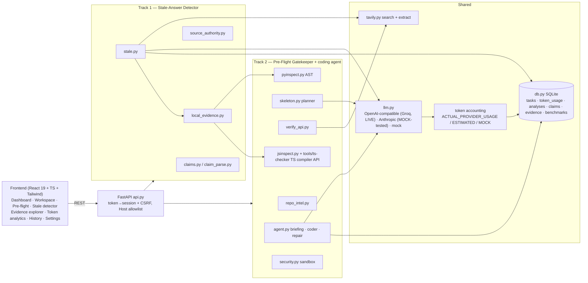
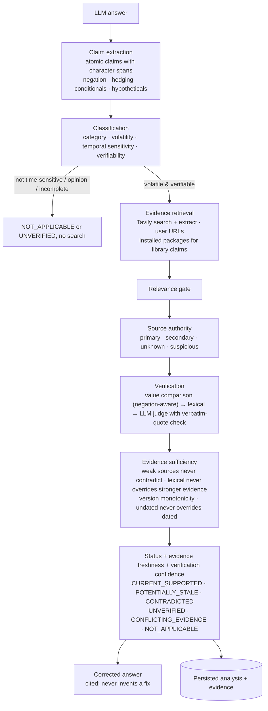
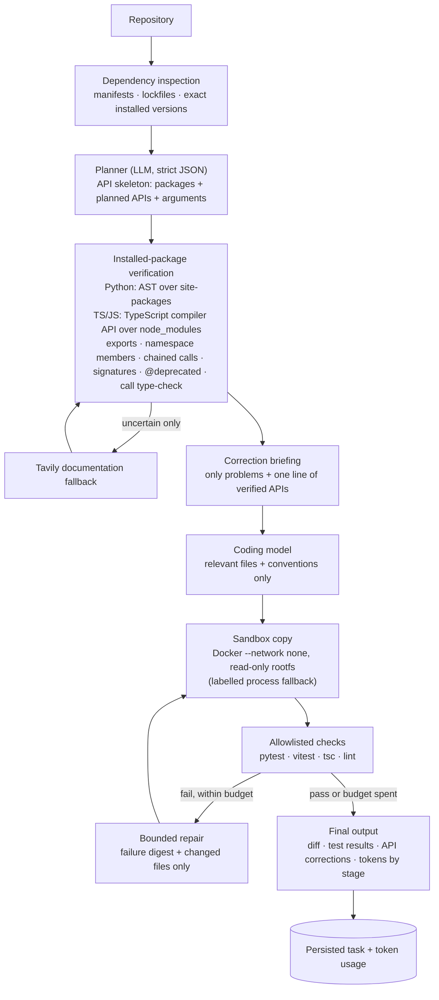

# VeriCode architecture (submission view)

Detailed module notes and formulas: [../ARCHITECTURE.md](../ARCHITECTURE.md). These diagrams match the modules in
`backend/vericode/`.

## System overview

## Track 1 workflow

## Track 2 workflow

## Combined workflow (why one product)
Track 2's installed-package verifiers are also evidence sources for Track 1. A claim such as "use `@validator` in
Pydantic" is checked against the pydantic version actually installed in the workspace (Demo E), not only against the
web.
